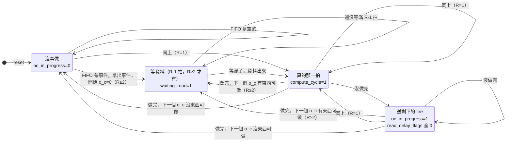
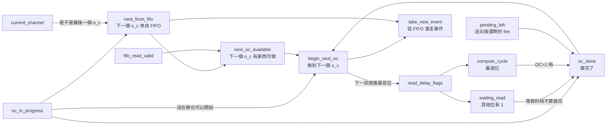

# SaltConv 控制狀態圖

對照 `SaltConv/SaltConv.srcs/sources_1/new/SaltConv.sv`。
「第 N 段」是那個檔案檔頭目錄的段落：0 共用控制、1 事件進來、2 下一個 o_c 是誰、3 CandidateGrid、4 候選暫存器、5 讀出算寫回、6 送出與做完沒。

控制用兩個暫存器：
- `oc_in_progress`（1 bit）：有 o_c 在做。
- `read_delay_flags`（`READ_LATENCY` 個 bit，記成 R）：這個 o_c 的讀位址送出後過了幾拍。
    - 開始一個 o_c 那拍，最低位放進 1；之後每拍往高位推一格。同一時間最多只有一個 bit 是 1。
    - 最高位是 1 就是 `compute_cycle`（算的那一拍）；其他 bit 有 1 就是 `waiting_read`（等資料）。

組出四種情況。R=1 時沒有「等資料」：開始 o_c 的下一拍就是算的那一拍。

## 圖上的條件

| 圖上寫的 | 程式碼 | 意思 |
|---|---|---|
| 做完 | `oc_done`（第 6 段） | 這一拍送出之後，這個 o_c 一個 fire 都沒剩，而且不是在等資料 |
| 沒做完 | `!oc_done` | 還有 fire 沒送：fire 不只一個、或下游 `out_ready=0`、或 OC=1 的算的那一拍 |
| 下一個 o_c 有東西可做 | `next_oc_available`（第 2 段） | 不是最後一個 o_c（做同一筆事件的 o_c+1），或 FIFO 有事件（做下一筆事件的 o_c=0） |
| FIFO 有事件 | `fifo_read_valid`（第 1 段） | 沒事做時，下一個 o_c 一定是 FIFO 那筆事件的 o_c=0 |
| 還沒等滿、等滿了 | `read_delay_flags` 往高位推 | 開始 o_c 後第 1～R-1 拍等資料，第 R 拍是算的那一拍 |

「做完而且下一個 o_c 有東西可做」就是 `begin_next_oc`，這一拍結束時 `read_delay_flags` 的最低位放進 1。

## 控制訊號怎麼算

左邊是這一拍開始時就有的值，往右一路算到 `begin_next_oc`、`take_new_event`。
上面那條（`next_from_fifo`、`next_oc_available`）只看暫存器和 FIFO，一開始就有答案，讀位址只用這條。
下面那條要等 `pending_left`：記憶體讀出 → NeuronUpdate → SpikeSelect 跑完才知道，是整顆電路最慢的路。

## 第 0 段那 5 個控制訊號

宣告在第 0 段，因為第 1 段起就要用；設定都在第 6 段最後。

| 訊號 | 種類 | 怎麼算 | 誰用 |
|---|---|---|---|
| `oc_in_progress` | 暫存器 | 換到下一個 o_c 時變 1；做完又沒有下一個時變 0 | 第 2 段決定下一個 o_c 從哪來；第 6 段 `out_valid`、`oc_done`、`bitmask` |
| `compute_cycle` | 組合邏輯 | `read_delay_flags` 的最高位 | 第 5 段寫回開關；第 6 段挑 fire 的來源、OC=1 不算做完 |
| `oc_done` | 組合邏輯 | 有 o_c 在做、不是在等資料，而且 `pending_left` 全是 0（OC=1 的算的那一拍除外） | `begin_next_oc`、`oc_in_progress` |
| `begin_next_oc` | 組合邏輯 | （`oc_done` 或沒在做）而且 `next_oc_available` | 第 2 段存 `current_channel`；第 4 段存候選；第 6 段 `read_delay_flags`、`oc_in_progress`、`take_new_event` |
| `take_new_event` | 組合邏輯 | `begin_next_oc` 而且 `next_from_fifo` | 第 1 段 FIFO 拿走最前面那筆、存事件暫存器 |

`read_delay_flags`、`waiting_read` 只在第 6 段用，宣告也在第 6 段。

## 每種情況這一拍在做什麼

| | 沒事做 | 等資料 | 算的那一拍 | 送剩下的 fire |
|---|---|---|---|---|
| 讀位址指向（第 2 段） | FIFO 那筆事件的 o_c=0 | 下一個 o_c | 下一個 o_c | 下一個 o_c |
| NeuronUpdate 的結果（第 5 段） | 不用 | 不用（資料還沒出來） | 寫回、拿去挑 fire | 不用（讀出的可能已經是下一個 o_c 的） |
| 挑 fire 的來源（第 6 段） | bitmask（全 0） | bitmask（全 0） | 剛算出的 fire | bitmask |
| bitmask 存什麼（第 6 段） | 清 0 | 全 0 | 這一拍沒送出的 fire | 這一拍沒送出的 fire |

## 逐拍例子（R=1）

OC=4，FIFO 裡只有一筆事件 A，下游一直收。
o_c=0～3 各 fire 0、2、1、0 個。

| 拍 | 情況 | 這個 o_c | 這拍送出 | `oc_done` | `next_from_fifo` | `next_oc_available` | `begin_next_oc` | `take_new_event` | 這拍送的讀位址 |
|---|---|---|---|---|---|---|---|---|---|
| 1 | 沒事做 | 無 | 無 | 0 | 1 | 1 | 1 | 1 | A 的 o_c=0 |
| 2 | 算的那一拍 | 0 | 無 | 1 | 0 | 1 | 1 | 0 | A 的 o_c=1 |
| 3 | 算的那一拍 | 1 | 第 1 個 fire | 0 | 0 | 1 | 0 | 0 | A 的 o_c=2 |
| 4 | 送剩下的 fire | 1 | 第 2 個 fire | 1 | 0 | 1 | 1 | 0 | A 的 o_c=2（重讀） |
| 5 | 算的那一拍 | 2 | 1 個 fire | 1 | 0 | 1 | 1 | 0 | A 的 o_c=3 |
| 6 | 算的那一拍 | 3 | 無 | 1 | 1 | 0 | 0 | 0 | 不讀（FIFO 空） |
| 7 | 沒事做 | 無 | 無 | 0 | 1 | 0 | 0 | 0 | 不讀 |

看幾個重點：
- 第 1 拍：沒在做，`oc_done` 是 0，靠 `|| !oc_in_progress` 才能開始。
- 第 3 拍：讀位址照送 o_c=2，但 `begin_next_oc=0`，下一拍讀出的不用，第 4 拍再讀一次。
- 第 6 拍：o_c=3 是最後一個，下一個要從 FIFO 來，FIFO 是空的，所以做完就回到沒事做。

一個 o_c 占 max(1, k) 拍，k 是它 fire 的個數：o_c=0～3 各占 1、2、1、1 拍。

## 逐拍例子（R=2）

同一個例子，R=2。`read_delay_flags` 寫成 [1][0]。

| 拍 | 情況 | 這個 o_c | `read_delay_flags` | 這拍送出 | `oc_done` | `begin_next_oc` | 這拍送的讀位址 | 這拍可用的讀出資料 |
|---|---|---|---|---|---|---|---|---|
| 1 | 沒事做 | 無 | 00 | 無 | 0 | 1 | A 的 o_c=0 | — |
| 2 | 等資料 | 0 | 01 | 無 | 0 | 0 | A 的 o_c=1 | — |
| 3 | 算的那一拍 | 0 | 10 | 無 | 1 | 1 | A 的 o_c=1 | o_c=0（第 1 拍讀的） |
| 4 | 等資料 | 1 | 01 | 無 | 0 | 0 | A 的 o_c=2 | — |
| 5 | 算的那一拍 | 1 | 10 | 第 1 個 fire | 0 | 0 | A 的 o_c=2 | o_c=1（第 3 拍讀的） |
| 6 | 送剩下的 fire | 1 | 00 | 第 2 個 fire | 1 | 1 | A 的 o_c=2 | 不用 |
| 7 | 等資料 | 2 | 01 | 無 | 0 | 0 | A 的 o_c=3 | — |
| 8 | 算的那一拍 | 2 | 10 | 1 個 fire | 1 | 1 | A 的 o_c=3 | o_c=2（第 6 拍讀的） |
| 9 | 等資料 | 3 | 01 | 無 | 0 | 0 | 不讀（FIFO 空） | — |
| 10 | 算的那一拍 | 3 | 10 | 無 | 1 | 0 | 不讀 | o_c=3（第 8 拍讀的） |
| 11 | 沒事做 | 無 | 00 | 無 | 0 | 0 | 不讀 | — |

看幾個重點：
- 第 2、4、7、9 拍：等資料，`waiting_read=1`，`oc_done` 一律是 0，不會推進。
- 第 2 拍也送了 o_c=1 的讀位址，讀出的沒用到；第 3 拍推進時重新送，第 5 拍用的是第 3 拍讀的。
- 第 6 拍：`read_delay_flags` 已經推出去變成全 0，挑 fire 的來源是 bitmask。

一個 o_c 占 (R-1) + max(1, k) 拍：o_c=0～3 各占 2、3、2、2 拍。

## OC=1

OC=1 時，算的那一拍一律算沒做完（第 6 段 `oc_done` 的條件），所以每個 o_c 至少經過「算的那一拍 → 送剩下的 fire」兩拍。
原因：OC=1 的下一個 o_c 是下一筆事件的 o_c=0，可能是同一顆神經元，要等這一拍寫回之後才能讀。
所以 OC=1 時一個 o_c 占 (R-1) + max(2, k) 拍。
