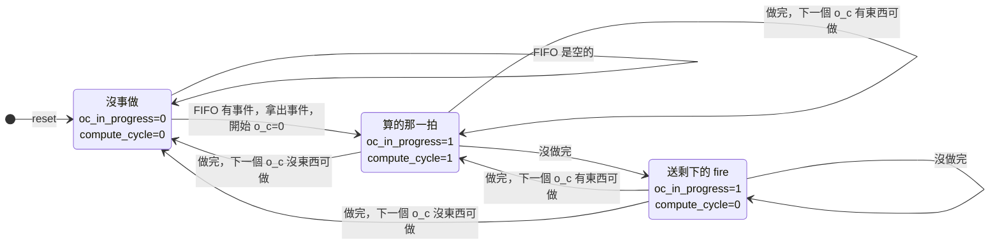

# SaltConv 控制狀態圖

對照 `SaltConv/SaltConv.srcs/sources_1/new/SaltConv.sv`，行號是那個檔案的行號。
控制只有兩個 1 bit 暫存器：`oc_in_progress`（有 o_c 在做）、`compute_cycle`（這一拍讀出的是這個 o_c 的資料）。
兩個 bit 組出三種情況；`oc_in_progress=0`、`compute_cycle=1` 不會出現，因為開始一個 o_c 時兩個一起變 1（第 423～425 行）。

## 圖上的條件

| 圖上寫的 | 程式碼 | 意思 |
|---|---|---|
| 做完 | `oc_done`（第 394～403 行） | 這一拍送出之後，這個 o_c 一個 fire 都沒剩 |
| 沒做完 | `!oc_done` | 還有 fire 沒送：fire 不只一個、或下游 `out_ready=0`、或 OC=1 的算的那一拍 |
| 下一個 o_c 有東西可做 | `next_oc_available`（第 163 行） | 不是最後一個 o_c（做同一筆事件的 o_c+1），或 FIFO 有事件（做下一筆事件的 o_c=0） |
| FIFO 有事件 | `fifo_read_valid` | 沒事做時，下一個 o_c 一定是 FIFO 那筆事件的 o_c=0 |

「做完而且下一個 o_c 有東西可做」就是 `begin_next_oc`（第 165 行），這一拍結束時 `compute_cycle` 變 1（第 423 行）。

## 每種情況這一拍在做什麼

| | 沒事做 | 算的那一拍 | 送剩下的 fire |
|---|---|---|---|
| 讀位址指向 | FIFO 那筆事件的 o_c=0 | 下一個 o_c | 下一個 o_c |
| NeuronUpdate 的結果 | 不用 | 寫回（第 317 行）、拿去挑 fire | 不用（讀出的可能已經是下一個 o_c 的） |
| 挑 fire 的來源（第 361 行） | bitmask（全 0） | 剛算出的 fire | bitmask |
| bitmask 存什麼（第 410 行） | 清 0 | 這一拍沒送出的 fire | 這一拍沒送出的 fire |

## 例子（OC=4，下游一直收）

| o_c | fire 個數 | 經過的情況 | 拍數 |
|---|---|---|---|
| 0 | 0 | 算的那一拍 | 1 |
| 1 | 2 | 算的那一拍（送第 1 個）→ 送剩下的 fire（送第 2 個） | 2 |
| 2 | 1 | 算的那一拍（送掉，沒剩） | 1 |
| 3 | 0 | 算的那一拍，FIFO 空的話之後回到沒事做 | 1 |

一個 o_c 占 max(1, k) 拍，k 是它 fire 的個數。

OC=1 時，算的那一拍一律算沒做完（第 394 行），所以每個 o_c 至少經過「算的那一拍 → 送剩下的 fire」兩拍。
原因：OC=1 的下一個 o_c 是下一筆事件的 o_c=0，可能是同一顆神經元，要等這一拍寫回之後才能讀。
所以 OC=1 時一個 o_c 占 max(2, k) 拍。
