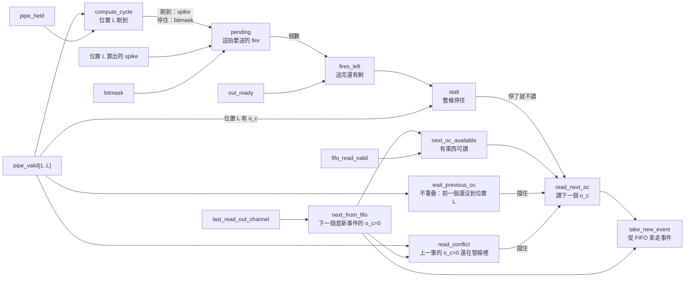

# SaltConv 控制：逐拍怎麼走

對照 `SaltConv/SaltConv.srcs/sources_1/new/SaltConv.sv`。
「第 N 段」是那個檔案檔頭目錄的段落：0 共用控制、1 事件進來、2 下一個 o_c 是誰與讀位址、3 CandidateGrid、4 管線位置、5 讀出算寫回、6 送出與換不換。
每個控制決定為什麼存在，見 [SaltConvOverview.md](../SaltConvOverview.md);設計推導見 Conv.md 5.8。

## 名詞

- R:`READ_LATENCY`,讀位址送出後幾拍資料出來(1 或 2)。
- C:`COMPUTE_LATENCY`,計算分幾級(1 或 2)。
- L = R + C − 1:`PIPELINE_DEPTH`,管線位置的個數。o_c 的讀位址送出後第 p 拍在位置 p;位置 R 是資料出來的位置，位置 L 是最後一個位置(寫回、挑 fire、送出)。
- k:一個 o_c fire 的個數。

## 控制用的暫存器

沒有狀態機，控制狀態就是下面這幾個暫存器。

| 暫存器 | 意思 | 什麼時候變 |
|---|---|---|
| `pipe_valid[1..L]` | 位置 p 有沒有 o_c | 沒停住的拍子整排往後推一格，位置 1 放 `read_next_oc` |
| `pipe_held` | 上一拍停住了 | 每拍存 `stall` |
| `bitmask` | 位置 L 的 o_c 之前沒送出的 fire | 每拍存「這拍送完剩下的」;位置 L 沒有 o_c 時清 0 |
| `last_read_out_channel` | 最近一次讀的 o_c | `read_next_oc` 那拍更新;reset 成 OC−1,第一個 o_c 就從 FIFO 拿 |

每個位置還各帶一份那個 o_c 的資料(`pipe_channel`、`pipe_time`、候選),跟 `pipe_valid` 一起推。

## 每拍怎麼算

左邊是這一拍開始時就有的值，往右一路算到 `read_next_oc`、`take_new_event`。
上面那條(`next_from_fifo`、`next_oc_available`)只看暫存器和 FIFO,一開始就有答案，讀位址只用這條。
下面那條要等位置 L 算出 spike,是整顆電路最慢的路之一。

時脈邊緣存起來的:
- `stall`=0:`pipe_valid`、`pipe_*` 往後推一格，位置 1 放 `read_next_oc` 和這次讀的 o_c 的資料。`stall`=1:全部不動。
- `pipe_held` ← `stall`。
- `bitmask` ← 位置 L 有 o_c 時，這拍送完剩下的 fire(`pending_left`)。
- `read_next_oc`=1:`last_read_out_channel` 更新，BRAM 讀出第一級讀進這次的位址。
- `stall`=0:BRAM 讀出第二級起(R=2 的輸出暫存器)往後推一級。所以讀出第 k 級永遠是位置 k+1 那個 o_c 的資料。
- C=2 的切點暫存器每拍都存，沒有開關。只有位置 L 剛到那拍用它，那拍它存的就是這個 o_c 的前半結果。

## 訊號一覽

| 訊號 | 段 | 怎麼算 | 誰用 |
|---|---|---|---|
| `compute_cycle` | 4 | `pipe_valid[L]` 而且 `!pipe_held` | 寫回開關、`pending` 取 spike 還是 bitmask |
| `pending` | 6 | 剛到：spike 而且候選合法;停住:`bitmask` | SpikeSelect、`fires_left`、`pending_left` |
| `fires_left` | 6 | 至少 1 個 fire,而且 `out_ready`=0 或不只 1 個 | `stall` |
| `stall` | 6 | `pipe_valid[L]` 而且 `fires_left` | 管線位置、讀出第二級起、`read_next_oc`、`pipe_held` |
| `next_from_fifo` | 2 | `last_read_out_channel` 是 OC−1 | 選這次要讀哪一筆、`next_oc_available`、`read_conflict`、`take_new_event` |
| `next_oc_available` | 2 | 不是新事件，或 FIFO 有事件 | `read_next_oc` |
| `wait_previous_oc` | 6 | 不重疊時，位置 1..L−1 有 o_c;重疊時固定 0 | `next_oc_blocked` |
| `read_conflict` | 6 | OC ≤ L 時：下一個是新事件的 o_c=0,而且位置 1..L 有 o_c=0;OC > L 時固定 0 | `next_oc_blocked` |
| `next_oc_blocked` | 6 | `wait_previous_oc` 或 `read_conflict` | `read_next_oc` |
| `read_next_oc` | 6 | `!stall`、`next_oc_available`、`!next_oc_blocked` | 位置 1、`last_read_out_channel`、BRAM 讀出第一級、`take_new_event` |
| `take_new_event` | 6 | `read_next_oc` 而且 `next_from_fifo` | FIFO 拿走最前面那筆、存事件暫存器 |

`stall`、`read_next_oc`、`take_new_event` 宣告在第 0 段，因為第 1 段起就要用。

## 逐拍例子 1:R=1、C=1(L=1)

OC=4,FIFO 裡只有一筆事件 A,下游一直收。o_c=0～3 各 fire 0、2、1、0 個。
L=1 時重疊開或關是同一個電路。

| 拍 | 位置 1 | 剛到？ | 這拍送出 | `stall` | `read_next_oc` | 這拍讀 |
|---|---|---|---|---|---|---|
| 1 | 空 | — | 無 | 0 | 1 | A 的 o_c=0(拿走 A) |
| 2 | A0 | 剛到 | 無 | 0 | 1 | A 的 o_c=1 |
| 3 | A1 | 剛到 | 第 1 個 fire | 1 | 0 | 不讀 |
| 4 | A1 | 停住 | 第 2 個 fire | 0 | 1 | A 的 o_c=2 |
| 5 | A2 | 剛到 | 1 個 fire | 0 | 1 | A 的 o_c=3 |
| 6 | A3 | 剛到 | 無 | 0 | 0 | 不讀(下一個要從 FIFO 來，FIFO 空) |
| 7 | 空 | — | 無 | 0 | 0 | 不讀 |

- 第 3 拍：A1 有 2 個 fire,送 1 個還剩 1 個，整條停住，不讀。
- 第 4 拍：A1 停在原地,`pipe_held`=1,不再寫回，要送的 fire 從 bitmask 拿;送完沒剩，同一拍讀 o_c=2。
- 一個 o_c 占 max(1, k) 拍：o_c=0～3 各占 1、2、1、1 拍。

## 逐拍例子 2:R=2、C=2、重疊(L=3)

同一個例子。位置 2 是資料出來的位置，位置 3 是最後一個位置。

| 拍 | 位置 1 | 位置 2 | 位置 3 | 位置 3 剛到？ | 這拍送出 | `stall` | 這拍讀 |
|---|---|---|---|---|---|---|---|
| 1 | — | — | — | — | 無 | 0 | A 的 o_c=0(拿走 A) |
| 2 | A0 | — | — | — | 無 | 0 | A 的 o_c=1 |
| 3 | A1 | A0 | — | — | 無 | 0 | A 的 o_c=2 |
| 4 | A2 | A1 | A0 | 剛到 | 無 | 0 | A 的 o_c=3 |
| 5 | A3 | A2 | A1 | 剛到 | 第 1 個 fire | 1 | 不讀 |
| 6 | A3 | A2 | A1 | 停住 | 第 2 個 fire | 0 | 不讀(FIFO 空) |
| 7 | — | A3 | A2 | 剛到 | 1 個 fire | 0 | 不讀 |
| 8 | — | — | A3 | 剛到 | 無 | 0 | 不讀 |

- 第 3 拍:A0 的資料從 BRAM 出來(位置 2),算計算前一半，拍子結束時存進切點暫存器;第 4 拍 A0 到位置 3,算後一半、寫回。
- 第 5、6 拍：停住時讀出第一級不讀、第二級不推，位置 2 的 A2 的資料原封不動留到第 7 拍。
- 從第 4 拍(第一個 o_c 到位置 3)起，一個 o_c 占 max(1, k) 拍，跟 L=1 相同;多出來的 L−1 拍只在最前面付一次。

## 逐拍例子 3:R=2、C=2、不重疊(L=3)

同一個例子，只看到 A1 送完。

| 拍 | 位置 1 | 位置 2 | 位置 3 | 這拍送出 | `stall` | `wait_previous_oc` | 這拍讀 |
|---|---|---|---|---|---|---|---|
| 1 | — | — | — | 無 | 0 | 0 | A 的 o_c=0(拿走 A) |
| 2 | A0 | — | — | 無 | 0 | 1 | 不讀 |
| 3 | — | A0 | — | 無 | 0 | 1 | 不讀 |
| 4 | — | — | A0 | 無 | 0 | 0 | A 的 o_c=1 |
| 5 | A1 | — | — | 無 | 0 | 1 | 不讀 |
| 6 | — | A1 | — | 無 | 0 | 1 | 不讀 |
| 7 | — | — | A1 | 第 1 個 fire | 1 | 0 | 不讀 |
| 8 | — | — | A1 | 第 2 個 fire | 0 | 0 | A 的 o_c=2 |

- 前一個 o_c 還在位置 1..L−1 時不讀;它到位置 L、而且沒停住的那拍才讀下一個。
- 一個 o_c 占 (L−1) + max(1, k) 拍：o_c=0、1 各占 3、4 拍。

## 逐拍例子 4:讀寫衝突(OC ≤ L)

R=2、C=2、重疊(L=3),OC=2。FIFO 裡有事件 A、B,兩筆碰到同一批神經元，都沒有 fire。

| 拍 | 位置 1 | 位置 2 | 位置 3 | 下一個 | `read_conflict` | 這拍讀 |
|---|---|---|---|---|---|---|
| 1 | — | — | — | A0 | 0 | A 的 o_c=0(拿走 A) |
| 2 | A0 | — | — | A1 | 0(不是新事件) | A 的 o_c=1 |
| 3 | A1 | A0 | — | B0 | 1(A0 在位置 2) | 不讀 |
| 4 | — | A1 | A0 | B0 | 1(A0 在位置 3,這拍寫回) | 不讀 |
| 5 | — | — | A1 | B0 | 0 | B 的 o_c=0(拿走 B) |
| 6 | B0 | — | — | B1 | 0 | B 的 o_c=1 |

- 第 4 拍如果讀 B0,讀跟 A0 的寫回同一拍、同一格，讀出的不保證是新值。第 5 拍讀，A0 已經寫好了。
- A0 第 1 拍讀、B0 第 5 拍讀，隔 L+1 步。只比 o_c=0 就夠：同一筆事件的 o_c 一步接一步讀，B1 跟 A1 也會隔 L+1 步(A1 第 5 拍寫回，B1 第 6 拍讀)。
- 位置 L 停住的拍子也算衝突。OC ≥ 2 時一定要這樣：上一筆的 o_c=1 可能沒停，下一步就寫回。OC=1 時那幾拍其實已經寫回了，但照同一條規則等，只留一套規則。
- OC=1 時一個 o_c 占 L + max(1, k) 拍：要等上一筆的 o_c=0 離開位置 L 才讀下一筆。
