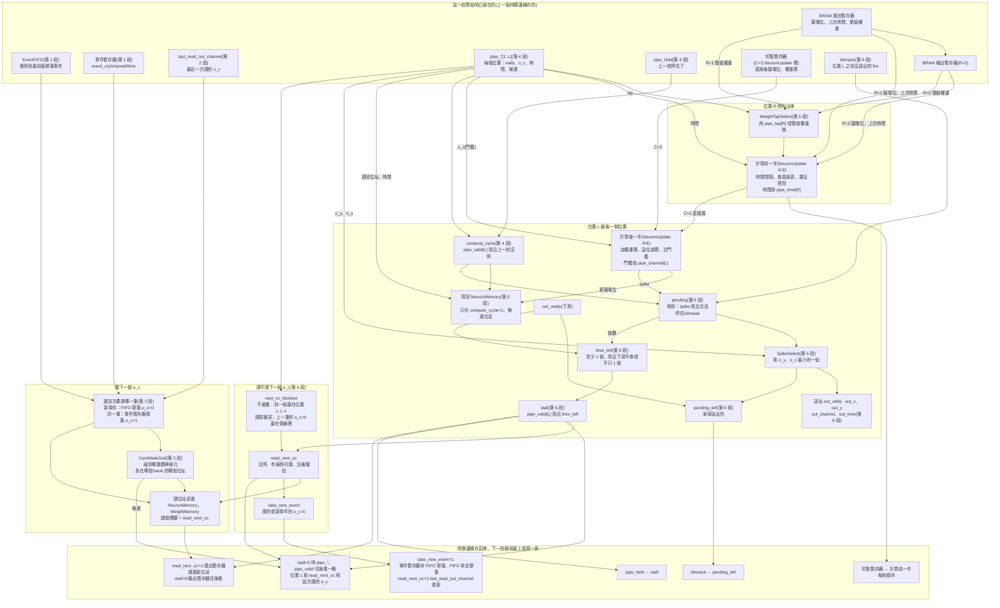

# SaltConv 資料流程圖

對照 `SaltConv/SaltConv.srcs/sources_1/new/SaltConv.sv`。
框裡的「第 N 段」是那個檔案檔頭目錄的段落：

| 段 | 內容 |
|---|---|
| 0 | 共用控制：`stall`、`read_next_oc`、`take_new_event` 的宣告(設定在第 6 段) |
| 1 | 事件進來：清除記憶體、FIFO、事件暫存器 |
| 2 | 下一個 o_c 是誰、讀位址、讀取開關、`last_read_out_channel` |
| 3 | 下一個 o_c 碰到哪些神經元(CandidateGrid) |
| 4 | 管線位置 1..L:每個位置一份那個 o_c 的候選、時間、o_c、valid |
| 5 | 讀出、算、寫回：權重、門檻、NeuronMemory + NeuronUpdate |
| 6 | 送出、還有沒有剩、停不停、讀不讀 |

R 是讀取延遲，C 是計算級數,L = R + C − 1 是管線位置的個數。o_c 的讀位址送出後第 p 拍在位置 p:位置 R 資料出來、算計算前一半，位置 L 算後一半、寫回、送出(C=1 時兩個是同一個位置)。

圖畫的是「一拍」裡發生的事，由上往下分成三排：
- 最上面：這一拍開始時已經在暫存器裡的東西(上一個時脈邊緣存的)。
- 中間：同一拍裡同時做的事。三塊各自處理不同的 o_c:「讀下一個 o_c」是還沒進管線的那個，「位置 R」是資料剛出來的那個，「位置 L」是最後一個位置上的那個。
- 最下面：這一拍結束的時脈邊緣存起來的東西，下一拍就變成最上面那一排。

R=2、C=2 的具體電路(每個暫存器放在哪一欄、控制線拉到哪)見架構總覽圖 [SaltConv架構總覽.drawio.svg](SaltConv架構總覽.drawio.svg)。

## 看圖的重點

- 讀位址只看最上面那排暫存器和 FIFO(第 2 段),不等 `stall`:下一個 o_c 是誰，這一拍一開始就知道。等 `stall` 的只有讀取開關。
- 同一拍裡三塊處理的是三個不同的 o_c(L=3 時)。讀用 CandidateGrid 剛算出的 `grid_*`,寫回用 `pipe_*[L]`,選權重和算時間間隔用 `pipe_*[R]`。
- 讀出暫存器跟管線位置用同一組條件移動：讀出第一級只在 `read_next_oc` 那拍讀，第二級起在 `stall`=0 時推。所以停住的拍子，位置 R 的 o_c 跟它的資料一起留著。
- 切點暫存器每拍都存，不接 `stall`。位置 L 只在剛到那拍(`compute_cycle`)用它，那拍它存的剛好是這個 o_c 的前半結果;停住的拍子不寫回，fire 改從 bitmask 拿。
- `fires_left` 只看要送的 fire 個數跟 `out_ready`,不等 SpikeSelect 挑完，`stall` 那條路比較短。
- 控制訊號每拍的值、四個逐拍例子，見 [SaltConvControl.md](SaltConvControl.md)。
