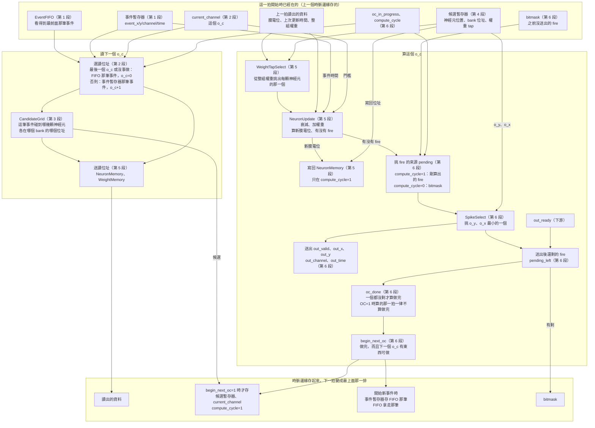

# SaltConv 資料流程圖

對照 `SaltConv/SaltConv.srcs/sources_1/new/SaltConv.sv`。
框裡的「第 N 段」是那個檔案檔頭目錄的段落：

| 段 | 內容 |
|---|---|
| 0 | 共用控制：5 個控制訊號的宣告（設定在第 6 段） |
| 1 | 事件進來：清除記憶體、FIFO、事件暫存器 |
| 2 | 下一個 o_c 是誰、讀位址、`current_channel` |
| 3 | 下一個 o_c 碰到哪些神經元（CandidateGrid） |
| 4 | 開始下一個 o_c 時存候選暫存器 |
| 5 | 讀出、算、寫回：權重、門檻、NeuronMemory + NeuronUpdate |
| 6 | 送出、做完沒、換不換 |

圖畫的是「一拍」裡發生的事，由上往下分成三排：
- 最上面：這一拍開始時已經在暫存器裡的東西（上一個時脈邊緣存的）。
- 中間：同一拍裡同時做的兩件事，「讀下一個 o_c」和「算這個 o_c」。
- 最下面：這一拍結束的時脈邊緣存起來的東西，下一拍就變成最上面那一排。

例子：算 o_c=0 的那一拍，同時已經在送 o_c=1 的讀位址。
o_c=0 沒有 fire 的話，下一拍就直接算 o_c=1，中間不空拍。

## 看圖的重點

- 讀位址只看最上面那排暫存器和 FIFO（第 2 段），不等同一拍的 `begin_next_oc`：下一個 o_c 是誰，這一拍一開始就知道。
- 讀出的資料要下一拍才出來，所以候選、o_c、事件也要在同一個時脈邊緣存起來，下一拍才對得上。
- 讀用中間「讀下一個 o_c」那塊的 `grid_*`，寫用最上面的 `candidate_*`：同一拍讀的跟寫的是不同的 o_c。
- 沒開始下一個 o_c 的拍子（還在送剩下的 fire、下游不收），下一拍讀出的資料不用，再讀一次。
  下一個 o_c 的神經元在它被算之前不會被寫，重讀拿到的值一樣。
- 下游 `out_ready=0` 時，挑出的那個沒送出去，就留在「送出後還剩的 fire」裡，這個 o_c 不算做完，不會換下一個 o_c。
- 控制訊號怎麼算、每拍的值，見 [SaltConvControl.md](SaltConvControl.md)。
